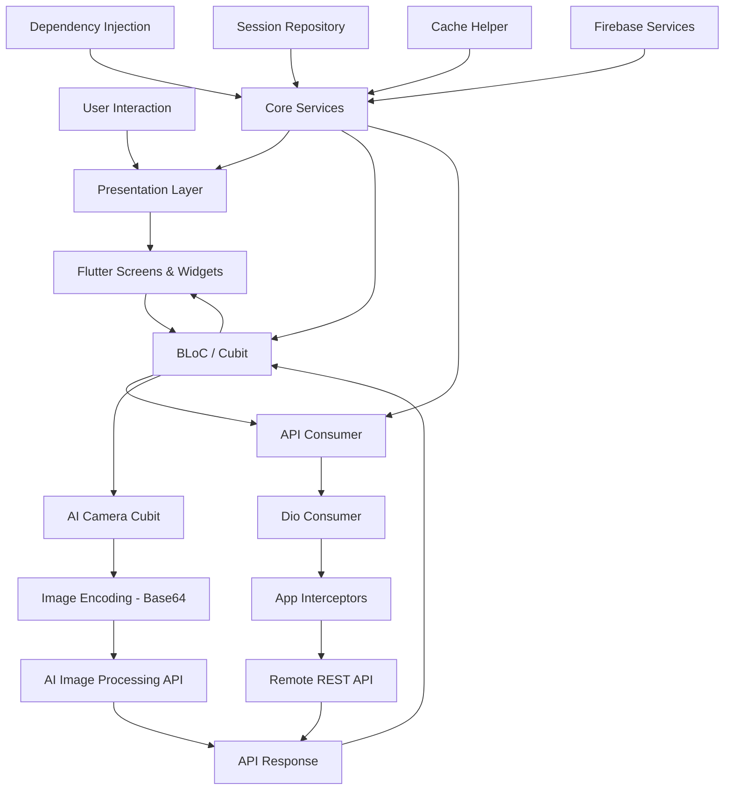

 <div align="center">


# ArchTech – Discover Ancient Civilizations

**An AI-powered Flutter application designed to help users explore, understand, and analyze ancient inscriptions and archaeological heritage.**

[](https://play.google.com/store/apps/details?id=com.codeman.archtech)
[](https://flutter.dev/)
[](https://dart.dev/)
[](https://bloclibrary.dev/)

</div>

---

## Overview

**ArchTech** is a Flutter-based mobile application designed to make archaeological knowledge more accessible through modern mobile technology and artificial intelligence.

The application helps users explore ancient civilizations, discover archaeological sites, and understand historical inscriptions written in different ancient languages.

By combining AI-powered image processing, interactive maps, location-based features, and multilingual support, ArchTech provides an interactive experience for tourists, explorers, and people interested in cultural heritage.

The application supports two main user experiences:

- **Tourist:** Explore archaeological sites, discover historical information, and navigate nearby locations.
- **Researcher:** Access research-oriented features and explore archaeological content.

The application communicates with remote REST APIs and a dedicated AI image-processing service.

## Key Features

### Authentication & User Management

- User registration and login.
- Forgot-password functionality.
- OTP verification.
- Password reset flow.
- Access-token and refresh-token management.
- User profile management.
- Session persistence.
- Role-based application navigation.

### AI-Powered Inscription Analysis

- Capture or select an image for analysis.
- Upload archaeological inscription images to the AI processing service.
- Process images using Base64 encoding.
- Receive analysis results from the AI service.
- Support language-specific processing.
- Validate image formats and file size before uploading.

### Archaeological Exploration

- Explore archaeological locations and ruins.
- Browse archaeological information.
- Discover historical places and their details.
- Access archaeological content and research screens.
- View shared archaeological images.
- Explore featured content through image sliders.

### Maps & Location Services

- Interactive Google Maps integration.
- Display archaeological locations on the map.
- Retrieve the user's current geographical location.
- Calculate distances between users and archaeological sites.
- Navigate to specific archaeological locations.
- Request and manage location permissions.

### Subscriptions & Payments

- Browse available subscription plans.
- View subscription details.
- Upgrade subscription plans.
- Integrate in-app purchase functionality.

### Notifications

- Firebase Cloud Messaging integration.
- Push-notification support.
- Local notification handling.
- Dedicated notification center.

### User Experience & Localization

- Arabic, English, French, and Chinese localization.
- Dynamic language selection.
- Persistent language preferences.
- Custom application theme.
- Adaptive navigation for Android and iOS.
- Loading and error states.
- Responsive image handling.

## Technology Stack

| Area | Technologies |
|---|---|
| Framework | Flutter |
| Language | Dart |
| State Management | BLoC / Cubit |
| Networking | Dio, HTTP |
| API Architecture | ApiConsumer abstraction |
| Dependency Injection | Custom Singleton Injection |
| Navigation | Named Routes, onGenerateRoute |
| Local Storage | SharedPreferences |
| Secure Storage | Flutter Secure Storage |
| Backend Integration | REST API |
| AI Integration | Dedicated Image Processing API |
| Firebase | Firebase Core, Firebase Messaging |
| Maps | Google Maps Flutter |
| Location | Geolocator |
| Authentication | Token-based Authentication |
| Notifications | Firebase Messaging, Flutter Local Notifications |
| Image Handling | Image Picker, CameraAwesome, Cached Network Image |
| Payments | In-App Purchase |
| Localization | Flutter Localization, Intl |
| Code Generation | Freezed, JSON Serializable, Build Runner |
| Utilities | Permission Handler, URL Launcher, Internet Connection Checker |

## Architecture

ArchTech follows a **feature-oriented Flutter architecture** with centralized application configuration and shared infrastructure.

The application separates major responsibilities into:

- **Presentation Layer:** Screens, widgets, BLoC, and Cubit classes responsible for user interaction and UI state.
- **Core Layer:** Shared API clients, networking, authentication sessions, local storage, error handling, and dependency initialization.
- **Configuration Layer:** Application routes, localization, and shared configuration.
- **Backend Integration:** Remote REST APIs and a dedicated AI image-processing service.

### Architecture Overview

The following diagram illustrates the main application communication flow.



### Core Architectural Components

**1. State Management – BLoC & Cubit**

The application uses `flutter_bloc` to manage application and feature states.

Examples include:

- `AuthBloc` for authentication.
- `HomeBloc` for archaeological content and user information.
- `GoogleMapBloc` for map-related operations.
- `AiCameraCubit` for AI image processing.
- `LocaleCubit` for language management.
- `SubscriptionsBloc` for subscription data.
- `UpgradeCubit` for subscription upgrade operations.

**2. Dependency Injection**

The application uses a centralized `Injection` Singleton to initialize and provide shared dependencies.

The initialization process includes:

- Firebase initialization.
- SharedPreferences initialization.
- CacheHelper setup.
- SessionRepository initialization.
- API client configuration.
- Application routing.
- Notification initialization.
- Locale initialization.
- Subscription BLoC setup.

**3. Networking & API Communication**

API communication is centralized through an abstract `ApiConsumer` and its `DioConsumer` implementation.

The networking layer supports:

- GET requests.
- POST requests.
- PUT requests.
- PATCH requests.
- DELETE requests.
- HEAD requests.
- Query parameters and request options.
- JSON response parsing.
- Centralized error handling.
- Request and response interceptors.

**4. Authentication & Session Management**

The application uses a session repository to manage authentication data.

Implemented capabilities include:

- Secure access-token storage.
- Refresh-token storage.
- Authentication status checking.
- Automatic token refresh handling.
- Authorization headers.
- Session expiration handling.

**5. Routing & Navigation**

Application navigation is managed through centralized route configuration.

The initial route is determined by:

- Onboarding completion status.
- Authentication status.
- User role (Tourist or Researcher).

Named routes are handled through `OnGenerateRoutes`, with BLoC providers initialized according to the requested feature.

### Project Structure

The following structure highlights the main source directories and responsibilities identified in the application.

```text
lib/
├── app.dart
├── main.dart
│
├── config/
│   ├── locale/
│   │   ├── app_localizations_setup.dart
│   │   └── locale.dart
│   │
│   └── routes/
│       ├── app_router.dart
│       ├── names.dart
│       ├── on_generate_routes.dart
│       └── route_imports.dart
│
├── core/
│   ├── _constants/
│   ├── _notification.dart/
│   ├── _settings/
│   ├── api/
│   ├── cache/
│   ├── error/
│   ├── extension/
│   ├── theme/
│   ├── bloc_observer.dart
│   └── injection.dart
│
├── features/
│   ├── Home/
│   │   ├── data/
│   │   │   └── models/
│   │   └── presentation/
│   │       ├── bloc/
│   │       ├── cubit/
│   │       ├── pages/
│   │       └── widgets/
│   │
│   ├── _auth/
│   │   ├── bloc/
│   │   └── model/
│   │
│   ├── _on_boarding/
│   │   └── bloc/
│   │
│   └── Subscriptions/
│       └── presentation/
│           └── bloc/
│
└── firebase_options.dart

assets/
├── images/
├── html/
│   ├── ar/
│   └── en/
├── Svg/
└── svg/

lang/
├── ar.json
├── en.json
├── fr.json
└── zh.json

test/
```

*Note: The structure above is a high-level representation of the source folders. Additional files and feature modules are maintained in the repository.*

## Application Flow

1. Initialize Flutter bindings and application dependencies.
2. Initialize Firebase services.
3. Load local preferences and secure session information.
4. Restore onboarding, authentication, and user-role states.
5. Determine the appropriate initial route.
6. Display onboarding or authentication screens when required.
7. Navigate authenticated users to the appropriate Tourist or Researcher experience.
8. Initialize the required feature BLoCs and Cubits.
9. Retrieve archaeological data and user information from remote APIs.
10. Allow users to explore archaeological locations, view content, and use AI image analysis.
11. Update the interface based on the emitted application states.

## Backend & API Integration

ArchTech communicates with remote backend services through a centralized networking layer.

### REST API

The application uses Dio through the `ApiConsumer` abstraction to handle API communication.

The API layer includes:

- Centralized base URL and endpoint configuration.
- Request headers and language configuration.
- Bearer-token authentication.
- Refresh-token handling.
- JSON response parsing.
- Error handling through custom API exceptions.

### AI Image Processing

The AI image-processing feature uses a dedicated service endpoint.

The processing flow is:

1. Capture or select an image.
2. Validate the image extension.
3. Check the image size (maximum 5 MB).
4. Convert the image bytes into Base64.
5. Send the image and selected language to the AI service.
6. Handle the processing response.
7. Update the UI with the resulting state.

### Firebase Integration

Firebase services are used for:

- Application initialization.
- Firebase Cloud Messaging.
- Push-notification integration.

## Local Storage & Security

The application uses different storage mechanisms according to the type of data.

| Storage | Purpose |
|---|---|
| SharedPreferences | Local preferences and cached application settings |
| Flutter Secure Storage | Authentication tokens and sensitive session information |
| SessionRepository | Authentication and session management |

Private configuration values and credentials must not be committed to a public repository.

## Getting Started

### Prerequisites

- Flutter SDK compatible with Dart `^3.6.0`.
- Dart SDK `^3.6.0`.
- Android Studio or Visual Studio Code.
- Android emulator or physical Android device.
- iOS development environment for iOS builds.
- Access to the required backend API services.
- Firebase project configuration.
- Required Google Maps and AI service configuration.

### Installation

1. Clone the repository:

```bash
git clone https://github.com/daliamansour11/Arch-Tech.git
```

2. Navigate to the project directory:

```bash
cd Arch-Tech
```

3. Install dependencies:

```bash
flutter pub get
```

4. Configure the required Firebase files and service credentials.

5. Configure the API and AI service endpoints in the project configuration.

6. Generate the required code if generated files need rebuilding:

```bash
dart run build_runner build --delete-conflicting-outputs
```

7. Run the application:

```bash
flutter run
```

### Build

To generate a release APK:

```bash
flutter build apk --release
```

To generate an Android App Bundle:

```bash
flutter build appbundle --release
```

## Screenshots

The following section is intended to showcase the main application screens.

| Onboarding & Authentication | Home Dashboard |
|---|---|
|  |  |

| Archaeological Exploration | Archaeological Details |
|---|---|
|  |  |

| AI Camera | AI Analysis |
|---|---|
|  |  |

| Interactive Map | User Profile |
|---|---|
|  |  |

*Replace these screenshot paths with the actual exported application screenshots before publishing the README.*

## Download the App

The ArchTech Android application is available on Google Play.

[**Download ArchTech on Google Play**](https://play.google.com/store/apps/details?id=com.codeman.archtech)

## Project Status

ArchTech is an existing Flutter application with integrated authentication, archaeological exploration, location-based services, AI image processing, subscriptions, and Firebase notification functionality.

This documentation describes the application structure and integrations identified in the repository. Availability of individual features depends on the corresponding backend services, API configuration, and user permissions.

## Future Improvements

- Expand automated unit and widget test coverage.
- Improve API documentation and integration guidelines.
- Add more detailed architecture documentation.
- Improve error handling and offline experiences.
- Expand archaeological content and supported inscription languages.
- Enhance performance and image-processing workflows.
- Add more application screenshots and usage examples.

## Author

**Dalia Mansour**

GitHub: [@daliamansour11](https://github.com/daliamansour11)

Project Repository: [Arch-Tech](https://github.com/daliamansour11/Arch-Tech)

---

<div align="center">

**ArchTech – Explore the Past. Understand History.**

</div>
